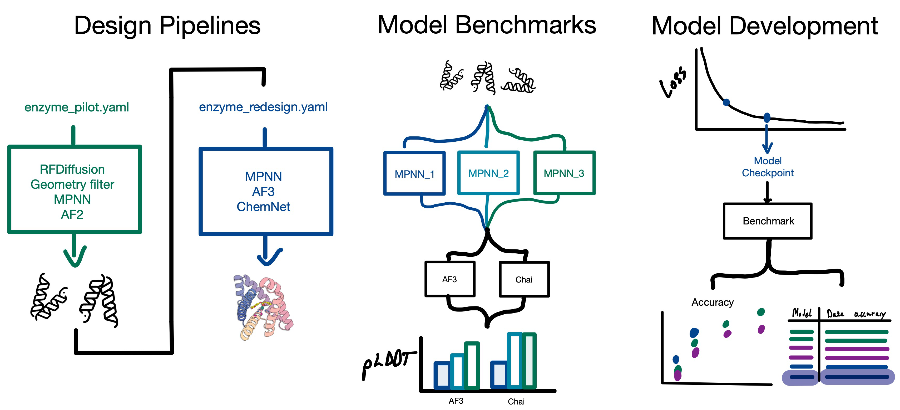

# Chaperone 

<p align="center">
  
  <figcaption>Figure 1: Overview of the uses of Chaperone. Left-to-right: Design, analysis, and on-the-fly benchmarking.</figcaption>
</p>

Chaperone is a unified framework for making structural biology tools interoperable.
Hook together design, sequencing, folding, and analysis into reproducible pipelines
with automatic SLURM orchestration, chunking, and path tracking.

Supported network blocks include RFD3NA, RFD3, RFD2, BindCraft, BoltzGen, Disco,
ProteinHunter, Protein/Ligand/FoundryMPNN, AF3, RF3, Boltz2, Chai1,
Protenix v2, OpenFold3, ESMFold2, E1, and ESM2.
Analysis blocks include RMSD, Foldseek, RASA, contact metrics, H-bond metrics,
and aromatic-neighbor scoring.
People have used Chaperone for PPI, symmetric design, and enzyme design — reach out to the respective experts if interested.

This repo ships with [agent skills](docs/site/skills.md) and project context (`AGENTS.md`) for writing, running, and debugging pipelines. The guides are Markdown files readable by Claude Code, Codex, and other coding agents; automatic discovery and slash commands depend on the agent installation.

> [!TIP]
> Start with the [documentation home](docs/site/index.md), [simple example](docs/site/simple.md), and [core examples](docs/site/core-examples.md).

> [!NOTE]
> Chaperone-authored code is [MIT licensed](LICENSE). External collaborators are welcome. Bundled third-party code and example outputs retain the terms listed in [Third-party notices](THIRD_PARTY_NOTICES.md); external tools and model weights retain their own licenses and access requirements.

## Installation (Agents)

First, install `uv` & Claude Code (or Codex):
- [uv](https://docs.astral.sh/uv/) via `curl -LsSf https://astral.sh/uv/install.sh | sh`, and,
- [Claude Code](https://docs.anthropic.com/en/docs/claude-code) via `curl -fsSL https://claude.ai/install.sh | bash`.

```bash
git clone https://github.com/RosettaCommons/chaperone.git
cd chaperone
export PYTHONPATH="$(pwd -P)/src${PYTHONPATH:+:${PYTHONPATH}}"
claude
# inside Claude Code, just type: /setup
```

The setup guide walks through creating a venv, installing dependencies, choosing a compute environment, configuring a container backend, and installing selected block containers. If `/setup` is unavailable, ask your agent to read `.agents/skills/setup/SKILL.md`. Some tools or weights require a separate upstream download or access agreement.

`/setup` is one of many skills Chaperone comes with, check out more below.

## Installation (Manual)

Requires Python 3.12+ and [uv](https://docs.astral.sh/uv/).

```bash
git clone https://github.com/RosettaCommons/chaperone.git
cd chaperone
export PYTHONPATH="$(pwd -P)/src${PYTHONPATH:+:${PYTHONPATH}}"
uv venv && source .venv/bin/activate
uv pip install -e '.[all]' --override overrides.txt
chaperone --help
```

The `PYTHONPATH` line stops an older checkout elsewhere on your path from shadowing this one. To confirm which copy you are running:

```bash
python -c "import chaperone, blocks; print(chaperone.__file__, blocks.__file__)"
```

Both paths should be inside this checkout.

Optional extras:

- **Jupyter kernel:** `python -m ipykernel install --user --name chaperone --display-name "Chaperone"`
- **PyRosetta** (only for the blocks that need it): set `PYROSETTA_PATH=/path/to/pyrosetta/setup` in `.env.local`, or run `python -c "import pyrosetta_installer; pyrosetta_installer.install_pyrosetta()"`. IPD users can supply an untracked `.env.ipd` pointing to their shared install.

On IPD, place your site-provided `.env.ipd` in the checkout root; it is loaded when present and is not tracked in Git. Other systems do not need it. Configure your container directories, model weights, and Slurm settings in `.env.local` (or use `CHAPERONE_ENV_FILE=/absolute/path/to/site.env`). See [Slurm site configuration](docs/site/syntax.md#slurm-site-configuration) for partition and GPU mappings. The optional `CHAPERONE_SITE=digs` preset is for IPD shared infrastructure only.

Block containers are built on demand: `chaperone list-available` shows them and `chaperone install <name> ...` builds one (`/setup` does this for you). Model weights are separate; each block's entry in the block reference says what it needs.

# Overview

Chaperone is a general framework for making structural biology tools interoperable. It is explicitly built as a *very simple* harness on top of tools: each tool is a **block** with a self-contained dataframe-in, dataframe-out API. Structure lineage, metrics, and metadata propagate automatically — so you can chain tools together, filter, analyse, and scale without manual bookkeeping.

It also provides [Claude Code](https://docs.anthropic.com/en/docs/claude-code) or [Codex CLI](https://github.com/openai/codex) with a robust harness for agentic automation at various levels: Claude can write, run, debug, and iterate on Chaperone scripts using built-in project context and skills.

### Core concepts

| Concept | What it does |
|---------|-------------|
| **Block** | A single tool wrapped as a dataframe-to-dataframe operation (e.g. `rfd3`, `mpnn`, `af3`, `rmsd`) |
| **PipelineDataHandler** | A schematized Polars DataFrame that carries structures, metrics, and lineage between blocks |
| **ExecutionEngine** | Orchestrates block execution — handles SLURM submission, chunking, caching, and data forwarding |

## Agent workflows

For iterative research, give `/auto-research` either acceptance thresholds or a
Chaperone-compatible `score.py`/`scorer.py`. It converts thresholds into one
tested scorer, runs baselines and candidate arms through that same scorer, and
uses the normal scorer and pipeline outputs to decide what to try next.

Search for the relevant skill, source symbol, or failure before opening large
files. For long jobs, let `ExecutionEngine` manage inner Slurm jobs and make one
stateless wait call for the detached outer driver rather than polling from agent
turns. Harbor exposes this as `campaign-monitor.wait`; standalone installations
can serve the same MCP tool with `chaperone monitor-mcp`. Process waits require
a completion marker because a detached exit code cannot be recovered without
persistent state. Non-agent supervisors can use the equivalent CLI:

```bash
chaperone wait --job-id 12345
chaperone wait --process-id 23456 --completion-marker run.done \
  --failure-marker run.failed
```

Read line-oriented artifacts through the Chaperone-wide bounded reader. Its
default output is capped at 200 lines and 20 KiB, and it returns a byte cursor
when more content remains:

```bash
chaperone artifact path/to/job.log --view events --tail
chaperone artifact path/to/job.log --view errors
chaperone artifact path/to/job.log --cursor BYTE_OFFSET
```

The same reader retrieves one piece of a large document or source file.
`--section` takes a markdown heading and stops at the next heading of the same or
higher level; `--start-line` takes a line number, so `rg -n` output composes
directly:

```bash
chaperone artifact docs/site/blocks-reference.md --section rfd3
rg -n 'def create_command' src/blocks/networks/rfd3.py
chaperone artifact src/blocks/networks/rfd3.py --start-line 412 --max-lines 60
```

### Supported blocks

**Design**: RFD3NA, RFD3, RFD3 Partial, RFD2, RFD1, BindCraft, BoltzGen, Disco, ProteinHunter

**Sequence**: ProteinMPNN, LigandMPNN, FoundryMPNN, abMPNN-PoE

**Prediction**: ESMFold2, OpenFold3, Boltz2, RF3/RF3 Dev, Protenix v2, Chai1, AF3, ColabFold

**Language**: E1, ESM2

**Analysis / Metrics**: RMSD, Foldseek, RASA, contact metrics, H-bond metrics, aromatic neighbor scoring

ProteinHunter is registered as `protein_hunter`. Its self-contained Apptainer
recipe pins Protein-Hunter commit `a3e048e96c93`, PyTorch 2.11, and CUDA 12.8,
and embeds the LigandMPNN weights and required Python packages. Build it with
`chaperone install protein_hunter`. Runtime still requires an NVIDIA GPU and a
CUDA-12.8-compatible driver, plus the Boltz2 checkpoint and CCD cache configured
by `BOLTZ_CACHE_DIR`. The image has been validated on an RTX A4000 at IPD with
a complete Boltz → soluble LigandMPNN → Boltz optimization cycle.

```python
designs = engine.run(
    "protein_hunter",
    protein_seqs="TARGET_SEQUENCE",
    msa_mode="single",
    num_designs=1,
    num_cycles=5,
    min_protein_length=90,
    max_protein_length=150,
)
```

Protenix v2 is exposed through the `protenix` block. The container uses Protenix
2.0.0 and supports the 464M v2 checkpoint plus Training-Free Guidance. The
compatibility default remains `protenix_base_20250630_v1.0.0`; select v2
explicitly when desired:

```python
engine.run(
    "protenix",
    data=designs,
    model_name="protenix-v2",
    use_tfg_guidance=True,
)
```

# Usage

## Task-appropriate pipeline composition

Select generators, sequence models, predictors, and metrics for the active
scientific task. Do not copy a workflow from a different design modality as a
default. The Chaperone scripting language supports moving the resulting script
from a small test to pilot and campaign scale.

## Examples

`examples/` holds a few worked pipelines: an FGFR2 binder campaign, the PPI, DISCO
and AME benchmarks, the prediction validation set, and a catcif storage walkthrough.
See [examples/README.md](examples/README.md) for the layout and how to run them.
For anything else, build the pipeline from the block reference and the skills index:

```bash
chaperone list-blocks
chaperone artifact docs/site/blocks-reference.md --section BLOCK_NAME
```

# Using agents and Claude Code

Chaperone is designed to work hand-in-hand with [Claude Code](https://docs.anthropic.com/en/docs/claude-code), Anthropic's CLI agent. The repo includes an `AGENTS.md` project guide and a suite of **skills** — specialized prompts that Claude can execute to perform common tasks.

## Agent evaluation containers

The agent evaluation harness lives under `src/chaperone-evals/harbor-controller/`,
separate from the installable runtime. Its images, mounts, scheduler policy, and
model assets are configured for the evaluation site. See the
[evaluation guide](docs/site/evaluations.md) for portable setup and the optional
digs configuration. Running ordinary blocks does not require an agent evaluation image.

## Agentic Skills
*Read the [skills guide](docs/site/skills.md) for discovery and use with different agents.*

1. **Start Claude Code** in the repo: `cd chaperone && claude`
2. **Use skills** by typing a slash command: `/setup`, `/design`, `/scripting`, etc. Claude will automatically read this but referencing them helps make it concrete which one to use
3. Claude reads `AGENTS.md` for project conventions, API patterns, and block documentation — so it can write, run, and debug Chaperone code with minimal guidance.

You can also just talk to the agent in natural language ("design a peptide binder for EIN2") and it will use its knowledge of the repo to build the right script.

### Chaperone skills

| Skill | What it does |
|-------|-------------|
| `/setup` | Install Chaperone, detect compute environment, build containers |
| `/design` | Plan and generate a pipeline script from a design spec |
| `/blocks-reference` | Compare blocks and choose tools by task, modality, cost and limitation |
| `/scripting` | Write, run and test a standalone pipeline script |
| `/auto-research` | Iteratively improve a weak or stalled workflow against a scorer |
| `/build-block` | Scaffold a new block from a tool's URL or docs |
| `/debugging-inputs` | Diagnose input prep issues (chain IDs, ligands, parsing) |

### General design skills

| Skill | What it does |
|-------|-------------|
| `/order-designs` | Generate DNA eblock orders from design PDBs |
| `/rosetta-params` | Generate and debug Rosetta `.params` files for ligands |
| `/slurm-interactive` | Persistent interactive SLURM session (GPU/CPU) for live, iterative work (written for IPD's `qlogin`; adapt elsewhere) |
| `/slurm-background` | Submit detached SLURM jobs (engine `job_args`, sbatch, nohup) for pilots/production; covers the site settings for partitions and GPU types |
| `/notebook-editing` | Edit, create, or execute Jupyter notebooks |
| `/visualize` | Inspect structures in PyMOL |
| `/order-collection` | Package a campaign's structures, metrics and summary into a handoff bundle |

We can very easily add more or adjust these as necessary!

## Example 1: Creating a new block from an existing script/repository
The example below is how one might add an MD-based tool to the repo:

```
> Read through /absolute/path/to/your-tool-repository and create a block using the `/build-block` skill. You should add this to the end of the test-pipeline under ./examples/benchmarks/ame on the af3 outputs with the ligand.
```

You can ask Claude out of the box to do this, but it'll be much faster if you either also tell claude "You have a local gpu" (after getting a GPU node, e.g. `qlogin --gres=gpu` at IPD or `salloc --gres=gpu:1` elsewhere) - that is, before opening `claude` on the terminal, or tell it to use `/slurm-interactive` - which will tell it to grab a gpu (or cpu) node via a qlogin tmux session (bit less clean but works!)

## Example 2: Creating a design plan / spec

Claude code has a "Planning Mode" for creating a plan before running any code, useful if you want to sanity-check what Claude intends to do before it actually does it.
The `/design` skill provides a template for Claude to run an entire design campaign if necessary.

The design spec consists of a plan to implement and test your pipeline at four levels of abstraction:

1. Implement code - what are the tools that need to be run?
2. Integration test plan - what is the base pipeline to string together? This forms the baseline for later experimentation, and can be tested easily with a single design.
3. Pilot experiments - What parameters are ambiguous about the pipeline and are there ways to iron them out? E.g. linker lengths, ORI tokens, guidance scales, MPNN parameters or the number of fixed residues to run.
4. Campaign-scale run - Plan to aggregate the experiments together for an estimate of the scale required to get an *orderable* amount of computational designs. You could also imagine this step consisting of the final analysis filters of MD, or more expensive steps.

For this, it helps to be super concrete about what your specification is before going ahead and launching claude. Take this example from Wenzhao:
```
# Linker design problem
You are provided with an existing structure file under: `files/I4132_a217_pipeline_input.pdb`.

This input contains:

- Chains A-F: A D3-symemtric complex for CoCO3 mineralization, of length 198 residues per chain.
- Chains G+H: A protein-crystal interface complex of C2 symmetry, 
consisting of 57 residues per chain.

Your task is to make a design plan---using the `/design` skill---to propose a suitable pipeline 
specification to generate a linker between the two complexes: in particular linking chain G and the 
interfacing chain from the D3-symmetric complex (chain B).

The interface between existing chains should be fixed, but the rest of the 
fused design (outside of the interface) can be backbone-fixed, sequence-redesigned and fused to one chain. 
Put your outputs in `examples/linker-design/`.
```

Claude will then ask some clarifying questions and create a comprehensive plan.

# Appendix
## MPNN sequence outputs

`MPNN()` and `FoundryMPNN()` now default to `output_mode="sequences"`. They do
not run side-chain packing or retain one CIF/PDB per sampled sequence. The
canonical rows live in `<step>/output.parquet`, and the engine also writes the
flat user-facing table `<step>/sequences.csv` with `design_id`,
`parent_design_id`, `sequence_<CHAIN>`, context, and MPNN confidence fields.

Prediction blocks (AF3, RF3, ESMFold2, Boltz2, Chai1, Protenix v2, OpenFold3,
and ColabFold) read these sequence rows directly. Protein sequences come from the
table; the retained parent structure supplies ligand, nucleic-acid, fixed-chain,
and template context. Coordinate-dependent analysis blocks fail clearly until a
prediction block has folded the sequence.

To restore the former materialized behavior, request it explicitly:

```python
MPNN(output_mode="structures")
FoundryMPNN(output_mode="structures")
```

`MpnnScore` remains compatible, but is no longer required merely to parse
confidence: sequence-native MPNN rows already contain the FASTA metrics.

## Storage formats and cleanups


Large campaigns (10k–1M designs) drown the rundir in per-design files. Chaperone supports catcif consolidation on each compiled block:

- `store="catcif"` — one concatenated-CIF archive per chunk (`<step>/<step>.chunk_N.catcif`); handler paths become self-describing `archive.catcif:entry_id` tags.

The engine defaults to **raw** (no archival, no cleanup) — every design lands as a loose file in its chunk sandbox. Opt in to consolidation by setting `auto_store_format` (and optionally `auto_store_cleanup`) on the engine, or per block via `store=`:

```python
engine = ExecutionEngine(
    rundir=...,
    auto_store_format="catcif",   # opt in: applies to every compiled block that didn't set store explicitly
    auto_store_cleanup=True,      # delete chunk sandboxes after archival
)
engine.run([RFD3(...), MPNN(...)])  # MPNN stays sequence-native; no catcif needed
engine.run(AF3(...), data=engine.compile())
```

**Before cleanup** (per chunk, RFD3 with `n_batches=2, rows_per_job=1`):

```
rundir/rfd3/
├── rfd3.chunk_0.catcif                              # 5 designs archived
├── rfd3.chunk_1.catcif                              # 5 designs archived
├── output.parquet                                   # step-level handler state
├── output.csv                                       # (debug view)
├── chunk_0/                                         # sandbox: the inner tool's workspace
│   ├── inputs/
│   │   └── rfd3_uncond_chunk0.json                  # staged RFD3 config
│   ├── manifest.json                                # command + cwd for this chunk
│   ├── output.parquet                               # chunk's handler slice
│   ├── output.csv
│   ├── rfd3_uncond_chunk0_uncond_0_model_0.json     # per-design config
│   ├── rfd3_uncond_chunk0_uncond_0_model_1.json
│   ├── rfd3_uncond_chunk0_uncond_0_model_2.json
│   ├── rfd3_uncond_chunk0_uncond_0_model_3.json
│   └── rfd3_uncond_chunk0_uncond_0_model_4.json
└── chunk_1/...
```

**After `auto_store_cleanup=True`**, all entire `chunk_i/` sandboxes are removed; only the archives and step-level parquet remain:

```
rundir/rfd3/
├── rfd3.chunk_0.catcif
├── rfd3.chunk_1.catcif
└── output.parquet
```

Two archive files plus a parquet per step — regardless of how many designs you produced. At 10k-design campaign scale the difference is the difference between a rundir with tens of thousands of loose files and one with a handful of archives.

### On-demand consolidation and materialization

Per-chunk archives are deliberately kept separate so failed chunks can be rerun independently. When you're done and want a single archive per step (e.g. for handoff), call `handler.store(...)` with a sentinel:

```python
handler.store("pending", rundir / "packaged")
# → structure-producing steps such as rfd3/af3 are archived; sequence-only MPNN is skipped
#   (sentinels: "all" = every step, "last" = final step only, "pending" = only unstored)
```

When a downstream tool needs loose files on disk, `materialize` extracts every archived entry:

```python
handler.materialize(rundir / "materialized", expand_catcif=True)
# → rundir/materialized/<step>/<entry_id>.cif, one file per design
# Pass expand_catcif=False to keep the catcif-tag form (readers resolve it transparently).
```

### Viewing catcifs in PyMOL

Locate `utils/pymol_load_catcif.py` in your `catcif_tools` checkout, then add
its absolute path to `~/.pymolrc`. For example (replace the placeholder path):

```
run /absolute/path/to/catcif_tools/utils/pymol_load_catcif.py
```

After that:

- `load /path/to/archive.catcif:entry_id` — load a single tagged structure.
- `load /path/to/archive.catcif` — slurp the whole archive (capped at 100 structures by default; raise with `catcif_max_load N`, or `catcif_max_load 0` for no limit).

Works via drag-and-drop too. See the [`visualize` skill](.agents/skills/visualize/SKILL.md) for structure inspection workflows.

# FAQ

**Q: Can I just run Claude code from anywhere?**
No, in order to initialize claude properly you should start claude code from the terminal under the root of the repo. Otherwise, just tell it to read the repo's contents from outside (not exactly equivalent but still effective).

**Q: Can I use custom versions of software?** Yes, you can override `template_command` to any `compiled` block (as appropriate) and reroute it to a different apptainer, or script. The `template_command` typically looks something like `template_command=\["apptainer", "run", "--nv", "path/to/sif.sif", "path/to/script.py"\]`. It's generated by default, because if apptainer's not available, it'll use `docker` instead.

**Q: How can I have agents run autonomous loops** This can be specified in the `/design` skill.

**Q: How do I add a new tool/block?**
Use the `/build-block` skill in Claude Code, or see the [block development guide](.agents/skills/build-block/SKILL.md) for the manual process.
