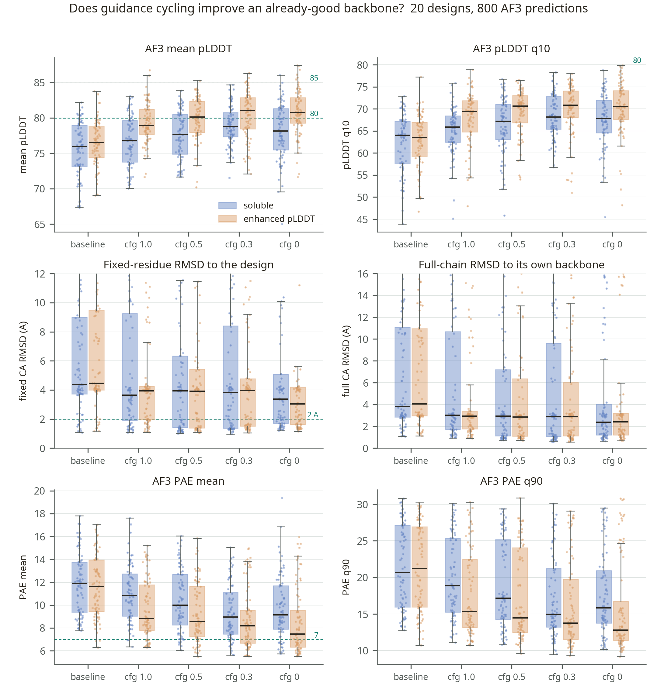
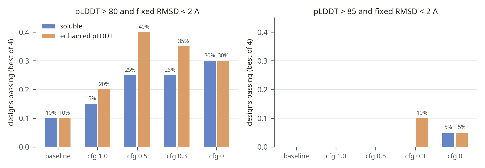

# Does guidance cycling improve an already-good backbone?

A measured dataset, not a runnable pipeline. 20 single-chain fusion designs from a
crystal-design campaign were each carried through five routes and two MPNN models, and
every resulting sequence was refolded with AF3. The table is the 800 predictions; the
two figures are drawn from it.

The question is narrow and practical: the generator already produced a backbone that
passed its structural filters, so is another round of structure generation worth its
compute, and which MPNN model should feed it.

## The experiment

| Axis | Levels |
|---|---|
| route | `baseline_mpnn_asu` (no cycling: the MPNN sequence on the generator backbone), then cycling at classifier-free guidance `cfg100`, `cfg050`, `cfg030`, `cfg000` |
| MPNN model | `soluble_mpnn`, and `enhanced_plddt`, the LigandMPNN variant with side-chain packing |
| sequences | 4 per design per cell |
| designs | 20, spanning space groups R32, I432, I4132, F4132 and P4132; 271-328 residues; linker lengths 9-25 |

`cfg000` switches guidance off rather than weakening it, so it is a mode change, not the
end of a ramp. Each cycled backbone is compared back to the design it came from, which
is what `af3_fixed_ca_rmsd_to_previous_mpnn_asu` measures over the positions held fixed.

## What the data shows

Pass rates count a design once if any of its four sequences clears the gate.

| Route | median AF3 pLDDT (soluble / enhanced) | pass, pLDDT > 80 and fixed RMSD < 2 A |
|---|---|---|
| baseline | 76.0 / 76.5 | 2/20 and 2/20 |
| cfg 1.0 | 76.8 / 78.9 | 3/20 and 4/20 |
| cfg 0.5 | 77.7 / 80.1 | 5/20 and 8/20 |
| cfg 0.3 | 78.8 / 81.0 | 5/20 and 7/20 |
| cfg 0 | 78.1 / 80.8 | 6/20 and 6/20 |

Cycling moves the whole distribution: every cycled arm has a higher median pLDDT and a
lower fixed-residue RMSD than the uncycled baseline. The gain is not monotone in
guidance, it flattens from `cfg050` onwards, so the useful reading is "cycle, and prefer
the packed `enhanced_plddt` model", not "lower guidance is better". At the stricter gate
(pLDDT > 85) almost nothing passes in any arm, 0-2 designs out of 20, so this benchmark
separates arms at the weaker gate only.





## Redraw

```bash
python examples/benchmarks/guidance-cycling/plot_comparison.py
```

Needs matplotlib and numpy, no GPU and no model weights. It writes both PNGs in
`.assets/` from `files/cycling_af3_metrics.csv` alone.

## Fixture provenance

`files/cycling_af3_metrics.csv` is the scored output of a smoke campaign run on
2026-10-17, 800 rows, all with `af3_status == OK`. One row is one AF3 prediction and
carries the run settings (`route`, `mpnn_mode`, `mpnn_sample_index`), the design's
geometry (`space_group`, `c2_motif`, `connection_order`, `terminal_ca_distance`,
`linker_length`, `rfd3_designed_length`, `round2_best_linker_length`, `n_fixed_residues`,
`chain_length_aa`), the RMSDs measured at each stage, and the AF3 metrics
(`ranking_score`, `fraction_disordered`, `has_clash`, `mean_plddt`, `plddt_q10`,
`pae_mean`, `pae_median`, `ipae_mean`, `pae_q90`, `pae_max`, and the fixed-residue and
full-chain CA RMSDs with their residue counts).

The designs are unpublished, so the table is de-identified: every column carrying residue
identities or amino acids was dropped, along with file paths, command lines, embedded
JSON and the internal design, candidate and model identifiers. Designs appear as
`case01`-`case20`. The campaign's structures and sequences are not part of this
repository.
