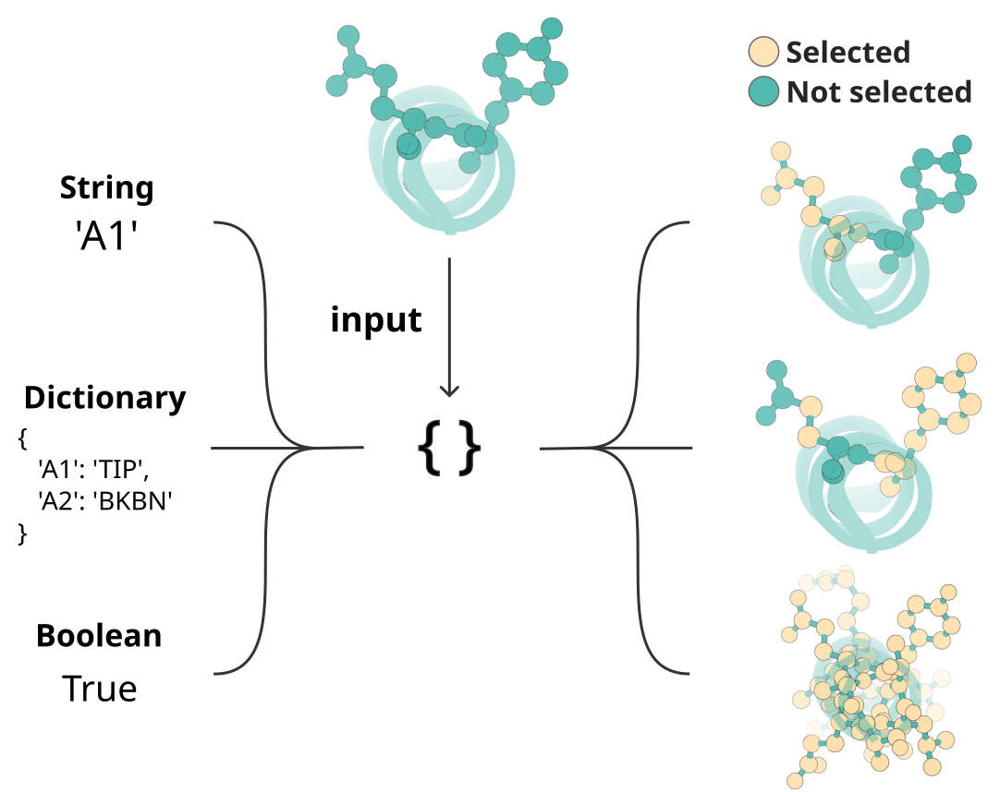
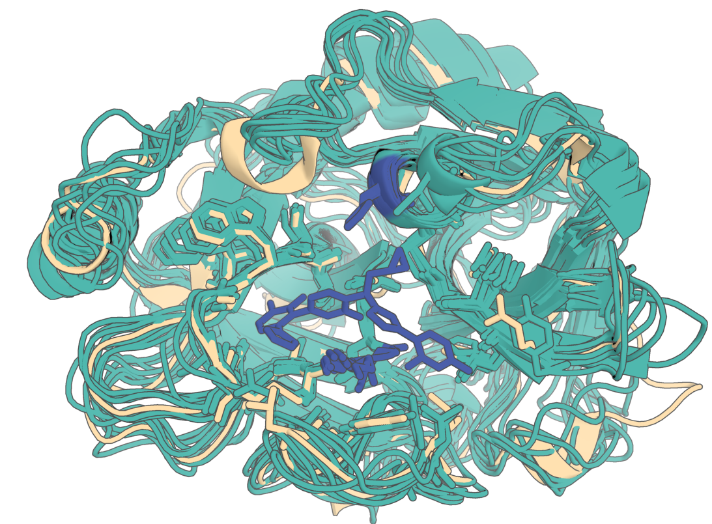
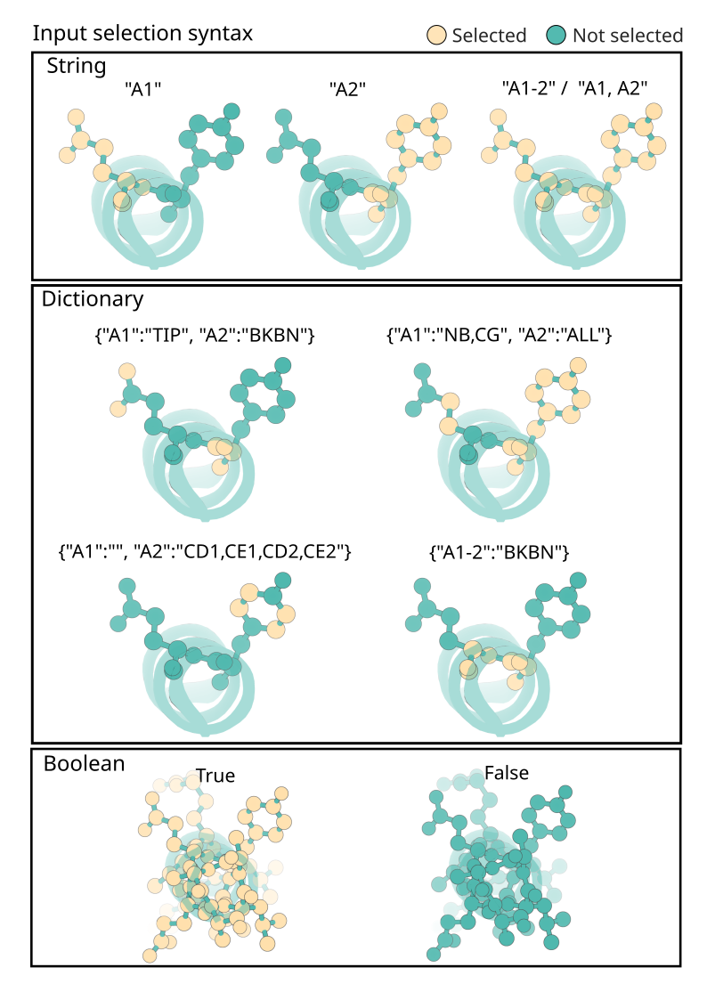

# RFdiffusion3 (`rfd3`) reference

Configuration, input format, and troubleshooting for the `rfd3` block defined
in `rfdiffusion3.py` beside this file.

The block takes `inputs=` a path to a JSON or YAML file. That file's schema is
defined by RFdiffusion3 itself, not by this repository, and is documented in
full under "Input specification" below — you should not need to read the block
source or hunt for an example to write one.

# RFdiffusion3 (RFD3) Reference

Comprehensive reference for writing and debugging RFD3 configs.

## Input Syntax

> **Upstream reference**: `upstream_input_reference.md` (in this skill directory) is a synced snapshot of the official RFD3 input docs from `RosettaCommons/foundry`. Refresh with: `.claude/sync_upstream_docs.sh rfdiffusion3`. Read it for the full canonical reference on CLI arguments, InputSpecification fields, contig strings, and CIF parser options.

### Top-level structure:
JSON inputs take the following nested top-level structure;
```json
{
    "spec-1": {  // First design configuration
      "input": "<path/to/pdb>",  // path to input file (optional)
      "contig": "50-80,/0,A1-100",  // Diffuses monomer sampled with length 50-80 for chain A & selects indices A1-100 in input pdb to have fixed coordinates and sequences  
      "select_unfixed_sequence": "A20-35", // Converts selected indices in input to have unfixed sequence (inputs become atom14).
      "ligand": "HAX,OAA",  // Selects ligands HAX and OAA based on res name in the input
    },
    "spec-2": {
      // ... args for the second (independent) configuration for design.
    }
}
```
This will configure RFD3 to run `spec-1` and `spec-2` as different output configurations. In pipelines, these get parsed as separate "tasks" in the dataframe, to allow for easy sweeps of configs

### Quick Reference: InputSpecification Fields

| Field | Type | Description |
|-------|------|-------------|
| `input` | `str` | Path to PDB/CIF file |
| `contig` | `InputSelection` | Indexed motif specification, e.g., `"A1-80,10,/0,B5-12"` |
| `unindex` | `InputSelection` | Unindexed motif components (position-agnostic in final sequence) |
| `length` | `str` | Total design length: `"min-max"` or int |
| `ligand` | `str` | Ligand(s) by CCD name, e.g., `"HAX,OAA"` |
| `select_fixed_atoms` | `InputSelection` | Atoms with fixed coordinates |
| `select_unfixed_sequence` | `InputSelection` | Regions where sequence can change |
| `select_buried` | `InputSelection` | RASA conditioning: buried atoms |
| `select_partially_buried` | `InputSelection` | RASA conditioning: partially buried atoms |
| `select_exposed` | `InputSelection` | RASA conditioning: exposed atoms |
| `select_hbond_donor` | `InputSelection` | H-bond donor atoms (dict only) |
| `select_hbond_acceptor` | `InputSelection` | H-bond acceptor atoms (dict only) |
| `select_hotspots` | `InputSelection` | Hotspots for binder design (≤4.5Å to designed structure) |
| `ori_token` | `list[float]` | `[x,y,z]` origin override for COM placement |
| `infer_ori_strategy` | `str` | `"com"` or `"hotspots"` |
| `partial_t` | `float` | Noise level (Å) for partial diffusion (5.0-15.0 recommended) |
| `is_non_loopy` | `bool` | `True` = fewer loops, **more helices, less sheets** (upstream FAQ). Set `false` (or unset) when you want β-sheet topologies. |
| `plddt_enhanced` | `bool` | Enable pLDDT enhancement (default: True) |
| `redesign_motif_sidechains` | `bool` | Fixed backbone, redesigned sidechains for motifs |
| `symmetry` | `SymmetryConfig` | Symmetry config (C/D groups) |

**Always use dialect 2** (the default). Dialect 1 is legacy and should not be used.

### InputSelection Mini-Language

InputSelections accept:
- **Boolean**: `True` (select all) / `False` (select none)
- **Contig string**: `"A1-10,B5-8"` - range selection
- **Dictionary**: `{"A1-10": "ALL", "B5": "N,CA,C,O"}` - atom-level control

**Atom specification shortcuts:**
| Shortcut | Meaning |
|----------|---------|
| `ALL` | All atoms |
| `BKBN` | Backbone only (N, CA, C, O) |
| `TIP` | Tip atoms (residue-specific) |
| `""` | No atoms (empty string) |

Example:
```yaml
select_fixed_atoms:
  A1-2: BKBN      # backbone only
  A3: N,CA,C,O,CB # specific atoms
  B5-7: ALL       # all atoms
  LIG: ''         # unfix ligand coordinates
```

### Contig String Format

Comma-separated sections describing the design:
- `A40-60` = residues 40-60 from chain A of input
- `70` = design exactly 70 new residues
- `40-80` = design 40-80 residues (random length within range)
- `/0` = chain break
- Length must account for all chains

Example: `A40-60,70,A120-170,/0,B3-45`

### CLI Arguments (Key Ones)

**Required:**
- `out_dir` - Output directory
- `inputs` - Path to JSON/YAML config file

**Common:**
| Argument | Default | Description |
|----------|---------|-------------|
| `n_batches` | 1 | Batches to generate per input key |
| `diffusion_batch_size` | 8 | Samples per batch |
| `json_keys_subset` | null | Run specific keys from JSON |
| `skip_existing` | True | Skip if output exists |
| `dump_trajectories` | False | Save diffusion trajectories |
| `prevalidate_inputs` | False | Validate inputs before loading weights |
| `low_memory_mode` | False | Memory-efficient tokenization |

### Inference Sampler Settings

| Setting | Default | Purpose |
|---------|---------|---------|
| `step_scale` | 1.5 | Higher = less diverse, more designable. **Use 3 for PPI** |
| `gamma_0` | 0.6 | Lower = more designable, less diverse. **Use 0.2 for PPI** |
| `gamma_min` | - | When t > gamma_min, gamma_0 is used |
| `cfg_scale` | 1.5 | Classifier-free guidance strength |
| `use_classifier_free_guidance` | False | Enable CFG |
| `cfg_features` | - | Features for CFG: `active_donor`, `active_acceptor`, `ref_atomwise_rasa` |
| `num_timesteps` | 200 | Diffusion timesteps |
| `s_jitter_origin` | 0.0 | Jitter ORI token placement |
| `center_option` | `all` | `all`/`motif`/`diffuse` for centering |
| `noise_scale` | 1.003 | Noise scaling (lower = less diversity) |

### Use Case Quick Reference

**PPI / Protein Binder Design:**
```json
{
  "input": "target.pdb",
  "contig": "40-120,/0,E6-155",
  "infer_ori_strategy": "hotspots",
  "select_hotspots": {"E64": "CD2,CZ", "E88": "CG,CZ"},
  "is_non_loopy": true
}
```
CLI: `inference_sampler.step_scale=3 inference_sampler.gamma_0=0.2`

**Enzyme Design (Unindexed Motifs):**
```json
{
  "input": "theozyme.pdb",
  "ligand": "NAI,ACT",
  "unindex": "A108,A139,A152",
  "length": "180-200",
  "select_fixed_atoms": {"A108": "ND2,CG", "A139": "OG,CB"}
}
```

**Small Molecule Binder:**
```json
{
  "input": "ligand.pdb",
  "ligand": "IAI",
  "length": "180-180",
  "select_fixed_atoms": {"IAI": ""},
  "select_buried": {"IAI": "C1,C2,C3"},
  "select_exposed": {"IAI": "O1,O2"}
}
```

**Partial Diffusion:**
```json
{
  "input": "input.cif",
  "partial_t": 15.0,
  "contig": "A1-100",
  "select_fixed_atoms": {"A1-30,A70-100": "ALL"}
}
```

**Symmetry (C/D only):**
```json
{
  "length": 100,
  "is_non_loopy": true,
  "symmetry": {"id": "C3"}
}
```
CLI: `inference_sampler.kind=symmetry diffusion_batch_size=1`

---

## Ori-Token Sweep

`ori_token` shifts the coordinate origin RFD3's `set_com` subtracts from input coords
before diffusion. Different shifts land the ligand in different bf16 quantization
buckets, so sweeping ori_token values across a structured lattice gives a *genuinely*
different design distribution per shell — much richer than the Gaussian noise from
`jitter_ori_sigma` (which perturbs a single ori_token rather than enumerating a grid).

The helpers live at `blocks.networks.foundry.ori_sweep`. Canonical flow:

```python
from blocks.networks.foundry.ori_sweep import generate_ori_points, write_merged_json

entries = generate_ori_points(
    input_pdb="files/target.pdb",
    ligand_name="LIG",
    exposed_atoms=["O1", "O2"],       # atoms that must stay solvent-facing; rays toward them are excluded
    surface_offsets=[5.0, 6.0, 7.0],  # Å from nearest ligand atom (shells)
    n_points=20,                       # Fibonacci directions before exclusion
    cone_half_angle=60.0,              # exclusion cone half-angle (deg)
)
sweep_json = write_merged_json("files/base.json", entries, "files/ori_sweep.json")
engine.run(RFD3(inputs=sweep_json, n_batches=10, batch_size=10))
```

`write_merged_json` takes the **first spec** from `base.json` as a template, clones it
once per entry, and stamps in the new `ori_token`. Each clone becomes an independent
RFD3 task whose name follows `ori_t{tier}_{fib_idx:02d}` (e.g. `ori_t0_05`,
`ori_t2_18`) and surfaces in `rfd3.metadata.task` for downstream group-by /
pass-rate ranking.

Use this instead of `jitter_ori_sigma` when you want a deterministic, structured
exploration of binding-pocket placements (e.g. for pilot pass-rate ranking before
scaling up only the top-performing shells).

---

## Outputs Reference

RFD3 produces one structure file (PDB/CIF) and one JSON metadata file per design. The `compile()` step reads these and builds a `PipelineDataHandler` with the structure name **`"rfd3"`**.

### Output File Structure

Each design produces two files in the sandbox directory:
- `{name}_model_{i}.cif` — the designed structure (B-factors encode sequence head confidence; `spectrum b` in PyMOL)
- `{name}_model_{i}.json` — full metadata: input spec, metrics, index mapping, checkpoint, seed

Trajectory files (if `dump_trajectories=True`):
- `{name}_denoised_model_{i}.cif` — denoised trajectory (excluded from compilation)
- `{name}_noisy_model_{i}.cif` — noisy trajectory (excluded from compilation)

### Output JSON Top-Level Fields

| Field | Type | Description |
|-------|------|-------------|
| `specification` | dict | Exact input spec used (with resolved fields) |
| `specification.extra` | dict | Sampled contig, actual length, task name, token/residue/chain/atom counts |
| `diffused_index_map` | dict | Maps original residue IDs → output residue IDs (e.g. `"A293": "A27"`) |
| `metrics` | dict | All quality/structural metrics (see table below) |
| `ckpt_path` | str | Checkpoint path used for inference |
| `seed` | int | Random seed |

### DataFrame Columns After `handler.unpack(all=True)`

After compilation and unpacking, you get these column groups:

#### Structure columns (`rfd3.*`)

| Column | Type | Description |
|--------|------|-------------|
| `rfd3.path` | str | Path to the output structure file (PDB/CIF) |
| `rfd3.metadata.task` | str | Task/example name from `specification.extra.example` |
| `rfd3.metadata.original_input` | str \| null | Path to the input PDB/CIF (null if de novo) |
| `rfd3.metadata.diffused_index_map` | str | JSON string of `{original_idx: output_idx}` mapping |
| `rfd3.metadata.motif` | list[str] \| null | Output residue IDs for motif residues (parsed from index map; excludes ligands) |
| `rfd3.metadata.ligand` | list[str] \| null | Ligand 3-letter codes (e.g. `["HAX", "OAA"]`) |

#### Metric columns (`rfd3.*`)

All metrics come directly from the output JSON `metrics` dict. They are stored in the handler's metrics field as `{<name>: {<metrics>}}` and flatten to `<name>.<key>` on unpack. Often, `<name>`=rfd3 so that is assumed for the rest of this document.

**Structural quality, clashes, secondary structure fractions & sequence composition metrics:**

| Column | Type | Range | Description |
|--------|------|-------|-------------|
| `rfd3.n_chainbreaks` | int | ≥0 | Number of chain breaks (want: 0) |
| `rfd3.max_ca_deviation` | float | ≥0 Å | Max Cα deviation from ideal geometry |
| `rfd3.radius_of_gyration` | float | >0 Å | Radius of gyration of the design |
| `rfd3.num_residues` | int | >0 | Total residue count in output |
| `rfd3.n_clashing.ligand_clashes` | int | ≥0 | Ligand-protein clashes (want: 0). Only present when ligands are in the design. |
| `rfd3.n_clashing.ligand_min_distance` | float | >0 Å | Minimum ligand-protein distance. Only present when ligands are in the design. |
| `rfd3.n_clashing.interresidue_clashes_w_backbone` | int | ≥0 | Backbone-backbone clashes (want: 0) |
| `rfd3.n_clashing.interresidue_clashes_w_sidechain` | int | ≥0 | Sidechain-sidechain/backbone clashes |
| `rfd3.non_loop_fraction` | float | 0–1 | Fraction of residues in helices or sheets (want: >0.2 typically) |
| `rfd3.loop_fraction` | float | 0–1 | Fraction of residues in loops |
| `rfd3.helix_fraction` | float | 0–1 | Fraction of residues in helices |
| `rfd3.sheet_fraction` | float | 0–1 | Fraction of residues in sheets |
| `rfd3.num_ss_elements` | int | ≥0 | Number of secondary structure elements |
| `rfd3.alanine_content` | float | 0–1 | Fraction of alanine residues |
| `rfd3.glycine_content` | float | 0–1 | Fraction of glycine residues |

**Sequence composition:**

| Column | Type | Range | Description |
|--------|------|-------|-------------|

**Coordinate information:**

| Column | Type | Description |
|--------|------|-------------|
| `rfd3.diffused_com` | list[float] | Center of mass [x,y,z] after centering (ORI position) |
| `rfd3.fixed_com` | list[float] | Center of mass [x,y,z] after moving — **use this for final output position** |

Can be used to measure COM conditioning adherence

**Unindexed motif metrics** (present only when `unindex` is used):

| Column | Type | Range | Description |
|--------|------|-------|-------------|
| `rfd3.insertion_rmsd` | float | ≥0 Å | RMSD of unindexed motif insertion vs input (IMPORTANT METRIC) |
| `rfd3.n_conjoined_residues` | int | ≥0 | Number of incorrectly fused residues at insertion points (Usually want: 0) |

Both metrics are essential filters for running unindexed components, and their adherence is often a very helpful metric to track and filter for.

**Filtered out internally:**
- `join_point_rmsd_by_token` — internal metric, excluded during `extract_rfd3_metadata()`. Can otherwise be used for residue-specific insertion rmsds.

### Common Filter Patterns

Based on core examples, these are typical quality filters applied to RFD3 outputs:

```python
from pipelines.data.handler import MetricFilter

# Universal filters (all design types)
filters = {
    "rfd3.n_chainbreaks": MetricFilter(max=0),           # No chain breaks
    "rfd3.non_loop_fraction": MetricFilter(min=0.8),      # At least 80% secondary structure
}

# Ligand-containing designs (enzymes, small molecule binders)
filters.update({
    "rfd3.n_clashing.ligand_clashes": MetricFilter(max=0),         # No ligand clashes
    "rfd3.n_clashing.ligand_min_distance": MetricFilter(min=2.0),  # Min 2Å ligand clearance
})

# Strict clash filtering
filters.update({
    "rfd3.n_clashing.interresidue_clashes_w_backbone": MetricFilter(max=0),
    "rfd3.n_clashing.interresidue_clashes_w_sidechain": MetricFilter(max=0),
})

# Unindexed motif designs
filters.update({
    "rfd3.insertion_rmsd": MetricFilter(max=0.5),          # Motif placed accurately
    "rfd3.n_conjoined_residues": MetricFilter(max=0),      # Clean insertion points
})
```

---

## Common Pitfalls / Debugging Tips

**Other Input Issues:**
- **Input without usage**: Providing `input` without `contig`, `unindex`, or `partial_t` causes "Input provided but unused" error
- **Residue ID truncation**: 4-digit residue IDs (e.g., B1046) truncated to 3 digits in output JSON
- **Duplicate ligand names**: Two ligands with same 3-letter code cause "Ambiguous bond annotations" error
- **Ligand names starting with numbers**: "00B" causes CIF parsing errors - rename to "0;B"
- **CCD conflicts**: Custom ligand names may conflict with existing CCD database entries (VERY COMMON)
- **Water (HOH) as ligand**: Sometimes can be filtered out as solvent - rename to "WAT" or use `cif_parser_args`
- **Repeated residue IDs**: Overlapping ranges like `A202-206,A206-207` can cause errors.

### Partial Diffusion Notes

**Partial diffusion requires explicit `select_fixed_atoms`:**
```json
{
  "input": "input.cif",
  "contig": "A1-75,A244-431",
  "partial_t": 20.0,
  "select_fixed_atoms": {"A1-75,A244-431": "ALL"}
}
```
Without `select_fixed_atoms`, atoms in the contig will be diffused even if you expect them to stay fixed.

**To redesign sequence in diffused region**, add `select_unfixed_sequence`:
```json
"select_unfixed_sequence": "A76-243"
```

**To fix backbone but allow sidechain repacking:**
```json
"select_fixed_atoms": {"A1-10": "BKBN"}
```

**`partial_t` interpretation**: Sets sigma (noise level in Å), not timesteps. Nonlinear - start small (2Å) and increase.

**Unindex with partial diffusion**: May produce unexpected results. Use `select_unfixed_sequence` instead when possible.

### Runtime/Output Issues

- **Extreme runtime variance**: Some jobs 10x longer on certain GPUs
- **CUDA OOM**: ~650aa at batch size 8 can exhaust A4000 memory

### Behavior Quirks

- **Non-globular folds**: Outputs often "rod-shaped" - more common with `is_non_loopy: True`
- **`select_unfixed_sequence`**: Fully relaxes to any AA (unlike legacy `unfix_sequence`)
- **Motif residue misallocation (PPI)**: ~1-2% of outputs can miscalculate unindexed motif allocation, pulling target residues into unindexed region. Risk factors: large unindexed regions, tight length constraints.

### ORI Token Coordinates

RFD3 centers the motif before diffusion:

| Field | Description |
|-------|-------------|
| `specification.ori_token` | ORI before centering (original input coords) |
| `diffused_com` | ORI after centering |
| `fixed_com` | ORI after moving - **use this for final output** |

If ORI appears far from output CoM, you're reading `specification.ori_token` instead of `fixed_com`.

---

## Debugging Recommendations

- **`cleanup_guideposts=False`** - See guidepost outputs for unindexed scaffolding (residues indexed together appear on same chain)
- **`cleanup_virtual_atoms=False`** - See all 14 diffused virtual atoms (default discards them)
- **`dump_trajectories=True`** - See diffusion trajectories (useful for strange outputs or cool gifs)
- **`prevalidate_inputs=True`** - Catch config errors before loading model weights

---

# Input specification

# RFdiffusion3 — Input Specification & Command-line arguments

RFdiffusion3 accepts inputs in two forms: 
- Constrains to be applied to the inference run are given in JSON or YAML files
- Details about the job (number of designs, output directory, etc.) are given as command line arguments

This document outlines the various input settings and configurations you can use with RFdiffusion3.

---

## Contents
- [Quick start](#quick-start)
- [CLI arguments](#cli-arguments)
  - [Required CLI Arguments](#required-cli-arguments)
  - [Other Useful CLI Arguments](#other-useful-cli-arguments)
  - [Other CLI options](#other-CLI-options)
- [InputSpecification fields](#inputspecification-fields)
- [The `InputSelection` mini-language](#the-inputselection-mini-language)
- [Contig Strings](#contig-strings)
- [Input Option Specifics](#input-option-specifics)
  - [Unindexing Specifics](#unindexing-specifics)
  - [Partial Diffusion](#partial-diffusion)
  - [CIF Parser Options](#cif-parser-options)
  - [Select Fixed Atoms](#select-fixed-atoms)
- [Debugging recommendations](#debugging-recommendations)
- [FAQ / Gotchas](#faq--gotchas)

---

(quick-start)=
## Quick start
> For more detailed information on RFdiffusion3 inputs and outputs, see {doc}`intro_inference_calculations`

JSON inputs take the following top-level structure;
```json
{
    "spec-1": {  // First design configuration
      "input": "<path/to/pdb>",
      "contig": "50-80,/0,A1-100",  // Diffuses length 50-80 monomer in chain A & selects indices A1 -> A100 in input pdb to have fixed coordinates and sequences  
      "select_unfixed_sequence": "A20-35", // Converts selected indices in input to have unfixed sequence (inputs become atom14).
      "ligand": "HAX,OAA",  // Selects ligands HAX and OAA based on res name in the input
    },
    "spec-2": {
      // ... args for the second (independent) configuration for design. 
    }
}
```

You can then run inference at the command line with:
```bash
rfd3 design out_dir=<path/to/outdir> inputs=<path/to/inputs>
```

(cli-arguments)=
## CLI arguments

(required-cli-arguments)=
### Required CLI arguments:
- `out_dir` — The directory that output files from the inference run will be stored in. If the directory does not exist it will be created. **This does not change how the output files are named.**
- `inputs` — The path and file name of the JSON or YAML file where you have defined your inference constraints. 

(other-useful-cli-arguments)=
### Other Useful CLI arguments:
(From the [default config](https://github.com/RosettaCommons/foundry/blob/production/models/rfd3/configs/inference_engine/rfdiffusion3.yaml))
- `n_batches` — number of batches to generate per input key (default: 1). 
- `diffusion_batch_size` — number of diffusion samples (designs) per batch (default: 8). If `n_batches=1` and `diffusion_batch_size=8` then 8 designs will be generated from the inference run. 
- `specification` — JSON overrides for the per-example InputSpecification (default: `{}`). For example, you can run `rfd3 design inputs=null specification.length=200` for a quick debug of creating a 200-length protein.
- `inference_sampler.num_timesteps` — diffusion timesteps for sampling (default: 200).
- `inference_sampler.step_scale` — scales diffusion step size; higher → less diverse, more designable (default: 1.5).
- `low_memory_mode` — memory-efficient tokenization mode; set `True` if GPU RAM is tight (default: False).
- `ckpt_path` — String containing he path and file name of the checkpoint path you want to use (default: rfd3)
- `skip_existing` — Skip designing any systems whose output files already exist in the specified `out_dir` (default: True).
- `global_prefix` — This setting allows you to change the beginning of the name of the output files from the name of the input JSON or YAML file to your own string (default: null).
- `dump_trajectories` — If True, the trajectory files are also saved to the specified output directory (default: False).
- `prevalidate_inputs` — Check that your inputs (JSON or YAML file) are valid before running inference (default: False).
- `low_memory_mode` - Set to True (default: False) for memory efficient tokenization mode. 

(other-cli-options)=
### Other CLI Options:
- `json_keys_subset` — Allows the user to extract only a subset of the JSON keys provided in the `inputs` file (default: null).
- `inference_sampler` —
  - `num_timesteps` — Number of diffusion denoising timesteps (default: 200). Controls how many steps the reverse diffusion process takes. More steps can improve quality at the cost of runtime.
  - `n_recycle` — Number of recycling iterations per diffusion step (default: null, uses the model checkpoint default of 2). Recycling allows the network to refine its predictions iteratively within each denoising step.
  - `kind` — Change this value to `symmetry` (default: default) to turn on symmetry mode for the inference sampler.
  - `cfg_features` — The values specified (options are `active_donor, active_acceptor, or ref_atomwise_rasa`) are set to 0 for classifier-free guidance. Classifier-free guidance is how the diffusion model can steer the calculation towards a condition without training a separate classifier.
  - `use_classifier_free_guidance` — If set to `True`, RFD3 can use classifier-free guidance to guide the system towards a condition without training a separate classifier (default: `False`).
  - `cfg_t_max` — The maximum time to apply classifier-free guidance to the inference run (default: null).
  - `cfg_scale` — Controls the influence of the classifier-free guidance adjustment (default: 1.5).
  - `center_option`: Specifies how to center the coordinates during the inference run to ensure that structures are alined around a specific point. Options include: 
    - `all` — (default) Uses the center of mass (COM) of all atoms
    - `motif` — Uses the COM of the motif atoms with fixed coordinates
    - `diffuse` — Uses the COM of all fixed coordinates that are not part of motif atoms
  - `s_trans` — Translational noise scale for augmentation during inference (default: 1.0). 
  <!-- `inference_noise_scaling_factor` As far as I can tell there isn't actually any code to make use of this setting -->
  - `allow_realignment` — If set to `True` (default: False) then the noised structure can be realigned during inference based on the location of a given motif. From [Issue #154](https://github.com/RosettaCommons/foundry/issues/154): It is generally not needed to include this option, there are fewer 'weird' interactions with motif scaffolding when it's set to False.
  - `noise_scale` — This parameter sets the scaling for the noise during inference (default 1.003). A smaller value will lead to less noise in your system leading to less diversity in the outputs. 
  - `p` — Determines the 'shape' of the noise schedule (default: 7).
  - `gamma_0` — This value (default: 0.6) influences the diversity of the designs from RFD3. A lower value increases designability but decreases diversity. 
  - `gamma_min` — Controls when `gamma_0` is used, if `t>gamma_min`, `gamma_0` is used as the value of `gamma`, which influences the diversity of the designs from RFD3.
  - `s_jitter_origin` — Controls the standard deviation of the Gaussian distribution that is used to 'jitter' the motif offset (default: 0.0, no jitter).
- `cleanup_guideposts` — Set to `False` (default: True) to save the guideposts used during inference, see [Debugging recommendations](#debugging-recommendations) for more information.
- `cleanup_virtual_atoms` — Set to `False` (default: True) to save information about the diffused virtual atoms used during inference. RFD3 uses virtual atoms to account for the different number of atoms in side chains during the design process. RFD3 is atom based, however the number of atoms in a residue will differ based on its side chain, which is only determined after some diffusion steps have occurred, meaning virtual atoms are necessary for those steps. See [Debugging recommendations](#debugging-recommendations) for more information.
- `read_sequence_from_sequence_head` — Used during training, it is not recommended to change this setting (default: True).
- `output_full_json` — Output all specification information to the JSON file that gets created for each design (default: True).
- `dump_prediction_metadata_json` — If `True`, the metadata for the inference run will be included in the output JSON file (default: True).
- `align_trajectory_structures` — Aligns the structures in the output trajectories (default: False).


The full config of default arguments that are applied can be seen in [inference_engine/rfdiffusion3.yaml](https://github.com/RosettaCommons/foundry/blob/production/models/rfd3/configs/inference_engine/rfdiffusion3.yaml)

(inputspecification-fields)=
## InputSpecification fields

Below is a table of all of the inputs that the `InputSpecification` accepts. Use these fields to describe the constraints you want to apply to your system during inference.

> For the fields with the `InputSelection` type, see section [The InputSelection Mini-Language](#the-inputselection-mini-language).

> Many of the settings here will mention a 'contig string', see the [Contig Strings](#contig-strings) section for more details.


| Field                                                          | Type              | Description                                                           |
| -------------------------------------------------------------- | ----------------- | --------------------------------------------------------------------- |
| `input`                                                        | `str`             | Path to and file name of **PDB/CIF**. Required if you provide contig+length.    |
| `atom_array_input`                                             | internal          | Pre-loaded [`AtomArray`](https://www.biotite-python.org/latest/apidoc/biotite.structure.AtomArray.html) (not recommended). |
| `contig`                                                       | `InputSelection`  | (Can only pass a contig string.) Indexed motif specification, e.g., `"A1-80,10,/0,B5-12"`.             |
| `unindex`                                                      | `InputSelection`  | (Can only pass a contig string or dictionary.) Unindexed motif components, the specified residues can be anywhere in the final sequence. See [Unindexing Specifics](#unindexing-specifics) for more information. |
| `length`                                                       | `str`             | Total design length constraint; `"min-max"` or int for specified length.                   |
| `ligand`                                                       | `str`             | Ligand(s) by chemical component name (from [RSCB PDB](https://www.rcsb.org/)) or index. |
| `cif_parser_args`                                              | `dict`            | Optional args to CIF loader. See [CIF parser options](#cif-parser-options) for more information. |
| `extra`                                                        | `dict`            | Extra metadata (e.g., logs). Current options include `sampled_contig`. |
| `dialect`                                                      | `int`             | `2`=new (default), `1`=legacy, Learn more about the legacy parsing system by looking at [input_parsing.py](https://github.com/RosettaCommons/foundry/blob/production/models/rfd3/src/rfd3/inference/input_parsing.py).|
| `select_fixed_atoms`                                           | `InputSelection`  | Atoms with fixed coordinates. See the [Select Fixed Atoms](#select-fixed-atoms) subsection for more information. |
| `select_unfixed_sequence`                                      | `InputSelection`  | Where sequence can change. Default is `True` - all input regions have fixed sequences. Contig string input specifies components to unfix the sequence for. Dictionary inputs are allowed but not recommended.|
| `select_buried` / `select_partially_buried` / `select_exposed` | `InputSelection`  | Selection of RASA (Relatively Accessible Surface Area) for buried, partially buried, and exposed conditioning, respectively. Only contig string and dictionary are acceptable inputs. |
| `select_hbond_donor` / `select_hbond_acceptor`                 | `InputSelection`  | Atom-wise donor/acceptor flags. Atom-wise selection of hydrogen bond donors and acceptors, respectively. Only dictionary inputs allowed. See {doc}`examples/na_binder_design` for an example. |
| `select_hotspots`                                              | `InputSelection`  | Atom-level or residue-level hotspots. Hotspots will typically be at most 4.5 Å to any heavy atom in the designed structure. Typically used for designing binders. |
| `redesign_motif_sidechains`                                    | `bool`            | Fixed backbone, redesigned sidechains for motifs (input structures). |
| `symmetry`                                                     | `SymmetryConfig`  | See {doc}`examples/symmetry`.                                               |
| `ori_token`                                                    | `list[float]`     | `[x,y,z]` origin override to control COM (center of mass) placement of designed structure. |
| `infer_ori_strategy`                                           | `str`             | `"com"` or `"hotspots"`.  The center of mass of the diffused region will typically be within 5Å of the ORI token. Using `hotspots` will place the ORI token 10Å outward from the center of mass of the specified hotspots. Using `com` will place the token at the center of mass of the input structure.|
| `plddt_enhanced`                                               | `bool`            | Default `True`. Enables pLDDT (predicted Local Distance Difference Test) enhancement. |
| `is_non_loopy`                                                 | `bool \| None`            | Default `None`. If `True`/`False`, produces output structures with fewer/more loops.|
| `partial_t`                                                    | `float`           | Noise (Å) for partial diffusion, enables partial diffusion (sets the noise level.) Recommended values are 5.0-15.0 Å. See [Partial Diffusion](#partial-diffusion) for more information. |


A few notes on the above:
- **Unified selections.** All per-residue/atom choices now use **InputSelection**:
  - You can pass `True`/`False`, a **contig string** (`"A1-10,B5-8"`), or a **dictionary** (`{"A1-10": "ALL", "B5": "N,CA,C,O"}`).
  - Selection fields include: `select_fixed_atoms`, `select_unfixed_sequence`, `select_buried`, `select_partially_buried`, `select_exposed`, `select_hbond_donor`, `select_hbond_acceptor`, `select_hotspots`.
- **Clearer unindexing.** For **unindexed** motifs you typically either fix `"ALL"` atoms or explicitly choose subsets such as `"TIP"`/`"BKBN"`/explicit atom lists via a **dictionary** (see examples). (`"ALL"` = all atoms, `"TIP"` = tip atoms, `"BKBN"` = backbone atoms.)
  When using `unindex`, only **the atoms you mark as fixed** are carried over from the input.
- **Reproducibility.** The exact specification and the **sampled contig** are logged back into the output JSON. We also log useful counts (atoms, residues, chains).
- **Safer parsing.** You’ll now get early, informative errors if:
  - You pass unknown keys,
  - A selection doesn’t match any atoms,
  - Indexed and unindexed motifs overlap,
  - Mutually exclusive selections overlap (e.g., two RASA bins for the same atom).
- **Backwards compatible.** Add `"dialect": 1` to keep your old configs running while you migrate. (Deprecated.)

---
(the-inputselection-mini-language)=
## The InputSelection Mini-Language

Fields marked as `InputSelection` accept either a boolean, a contig-style string, or a dictionary. Dictionaries are the most expressive and can also use shorthand values like `ALL`, `TIP`, or `BKBN`:
```yaml
select_fixed_atoms:
  A1-2: BKBN # equivalent to 'N,CA,C,O'
  A3: N,CA,C,O,CB  # specific atoms by atom name
  B5-7: ALL # Selects all atoms within B5,B6 and B7
  B10: TIP  # selects common tip atom for residue (constants.py)
  LIG: ''  # selects no atoms (i.e. unfixes the atoms for ligands named `LIG`)
```

<!--<p align="center">
  
</p>-->
```{figure} .assets/input_selection.png
---
alt: Input selection language for foundry.
width: 500px
---
Graphical representation of the different ways to specify portions of a structure using RFD3's InputSelection mini-language. 
```


(contig-strings)=
## Contig Strings
A 'contig string' is a string that contains residue information and is used in many of the settings in the table above. Here are some formatting specifics: 
- Different pieces of information included in the string are separated by commas
- Ranges of residues are specified by a dash (`-`) between the starting and ending residue
- Chain breaks are represented by `/0`
- Residue numbers or ranges with a chain label before the number come from the input structure
- Residue numbers or ranges without a chain label before the number will be designed. If given a range, the designed region will have a length that is uniformly random within the specified range. 

For example: 
```yaml
my_calculation: 
    input: path/to/my/input.pdb
    contig: A40-60,70,A120-170,A203,/0,B3-45,60-80
```
- `A40-60`: the design will start with residues 40-60 from the A chain of the input structure. 
- `70`: RFD3 will design a chain with exactly 70 residues that will connect to A60
- `A120-170`: RFD3 will include a bond between the last designed residue and residue A120, and then include residues A120-A170 from the input structure.
- `A203`: A bond will be created between A170 and A203 and A203 will be in the final structure. However, residues A171-A202 will not be in the final structure. 
- `/0`: Chain break. There is no peptide bond between A203 and B3 in the output structure
- `B3-B45`: Residues B3 thru B45 are taken from the input structure. 
- `60-80`: A design region is added B45 that will be between 60 and 80 residues long.

(input-option-specifics)=
## Input Option Specifics

(unindexing-specifics)=
### Unindexing Specifics
```{note}
Unindexed atoms are **always** fixed unless otherwise specified in the `select_fixed_atoms` option. At least one atom in any unidexed residue needs to be fixed.
```

`unindex` marks motif tokens whose relative sequence placement is unknown to the model (useful for scaffolding around active sites, etc.). 
To specify the unindexed regions of your design you can: 
- Use a string to list the unindexed components and where breaks occur.
- Use a dictionary if you want to fix specific atoms of those residues; atoms not fixed are not copied from the input (they will be diffused).
Breaks between unindexed components follow the contig conventions you’re used to. For example: `"A244,A274,A320,A329,A375"` lists multiple unindexed components; internal “breakpoints” are inferred and logged. (Offset syntax like `A11-12` or `A11,0,A12` still ties residues.)
You can specify consecutive residues as e.g. `A11-12` (instead of `A11,A12`), this will tie the two components together in sequence (or at least it leaks to the model that residues are together in sequence). 
Similarly, you can specify manually any number of residues that offsets two components, e.g. `A11,0,A12` (0 sequence offset, equivalent to just `A11-12`), or `A11,3,A12` (3-residue separation).
From our initial tests this only leads to a slight bias in the model, but newer models may show better adherence!

(partial-diffusion)=
### Partial Diffusion

```{important}
Partial diffusion (`partial_t`) does *not* directly change the number of timesteps reversed during the inference process. It sets the standard deviation of the noise added back. This value is nonlinear, so it is recommended to start with a relatively small value (2Å) and gradually raise it. 
```

To enable partial diffusion, you can pass `partial_t` with any example. This sets the *noise level* in *angstroms* for the sampler:
- The `specification.partial_t` argument can be specified from your JSON/YAML input file
- Partial diffusion will fix/unfix ligands and nucleic acids as normal, by default it will fix non-protein components and they must be specified explicitly.
- By default, the ca-aligned `ca_rmsd_to_input` will be logged.
- Currently, partial diffusion subsets the inference schedule based on the partial_t, so `inference_sampler.num_timesteps` will affect how many steps are used but it is not equal to the number of steps used.

In the following example, RFD3 will noise out by 15 angstroms and constrain atoms of three residues. In this output one of the 8 diffusion outputs swapped its sequence index by one residue:
```json
{
    "partial_diffusion": {
        "input": "input_pdbs/7v11.cif", 
        "ligand": "OQO", 
        "partial_t": 15.0,
        "unindex": "A431,A572-573",
        "select_fixed_atoms": {
            "A431": "TIP",
            "A572": "BKBN",
            "A573": "BKBN"
        }
    }
}
```
Below is an example of what the output should look like (diffusion outputs in teal, original native in navajo white):
<!--<p align="center">
  
</p>-->
```{image} .assets/partial_diff.png
:alt: Partial diffusion.
:width: 650px
```

(cif-parser-options)=
### CIF Parser Options
The `cif_parser_args` setting that you can include in your input JSON or YAML file accepts several possible values as a dictionary: 
- `cache_dir`: String specifying the path to the directory where cache files are stored (default: null).
- `load_from_cache`: Boolean specifying if data should be loaded from cache (default: True).
- `save_to_cache`: Boolean specifying if the data should be saved to cache (default: True).
- `fix_arginines`: Boolean specifying if arginine residues should be fixed (default: False).
- `add_missing_atoms`: Boolean specifying if missing atoms should be automatically added (default: False).
- `remove_ccds`: A list of CCD ([chemical component dictionary](https://www.wwpdb.org/data/ccd)) keys to remove (default: []).
- `hydrogen_policy`: String specifying how hydrogens should be handled. Current options are `remove`. (Default: remove).
- `extra_fields`: These optional fields can be found by looking at AtomWorks' [`parser.py` file](https://github.com/RosettaCommons/atomworks/blob/production/src/atomworks/io/parser.py).

You can also use `STANDARD_PARSER_ARGS` from [AtomWorks](https://github.com/RosettaCommons/atomworks), more information can be found at [atomworks/io/parser.py](https://github.com/RosettaCommons/atomworks/blob/production/src/atomworks/io/parser.py)

(select-fixed-atoms)=
### Select Fixed Atoms
The `select_fixed_atoms` input setting can take a boolean, dictionary or contig string as input: 
- `True`: All atoms pulled from the input file (via `contig`, for example) are fixed in 3D space
- `False`: All the atoms pulled from the input file are unfixed in 3D space
- Contig string: See the [Contig Strings](#contig-strings) section for formatting. Specifying a contig string for this setting allows for the specification of several components to fix in 3D space. This string should only reference residues from the input. Chain breaks are irrelevant for this setting. 
- Dictionary: Allows for the specification of specific atoms within the residue to be fixed in 3D space. For example, `{"A1": "N,CA,C,O,CB,CG", "A2-10": "BKBN"}` fixes backbone and CB for residues 1 and 2, and all atoms for residues 3-10 in chain A.

(debugging-recommendations)=
## Debugging recommendations
- For unindexed scaffolding, you can use the option `cleanup_guideposts=False` to keep the models' outputs for the guideposts. The guideposts are saved as separate chains based on whether their relative indices were leaked to the model: e.g. for `unindex=A11-12,A22`, you should see `A11` and `A12` indexed together on one chain and `A22` on its own chain, indicating the model was provided with the fact that `A11` and `A12` are immediately next to one another in sequence but their distance to `A22` is unknown.
- To see the full 14 diffused virtual atoms you can use `cleanup_virtual_atoms=False`. Default is to discard them for the sake of downstream processing.
- To see the trajectories, you can use `dump_trajectories=True`. This can be useful if the outputs look strange but the config is correct, or if you want to make cool gifs of course! Trajectories do not have sequence labels and contain virtual atoms.

(faq--gotchas)=
## FAQ / Gotchas

<details>
<summary><b>Can I guide on secondary structure?</b></summary>
Currently no - in future models we may do so, however, you can use `is_non_loopy: true` to make fewer loops. We find this produces a lot more helices and fewer loops (and less sheets).
</details>

<details>
<summary><b>Do I need select_fixed_atoms & select_unfixed_sequence every time?</b></summary>
No. Defaults apply when input present.
</details>


<details>
<summary><b>Why "Input provided but unused"?</b></summary>

This indicates you gave an input pdb / cif (not `input: null`) but no contig, unindex, ligand, and/or partial_t.
</details>

<details>
<summary><b>What do the logged bfactors mean?</b></summary>

The sequence head from RFD3 logs its confidence for each token in the output structure, you can run `spectrum b` in `pymol` to see it. It usually doesn't mean anything but can give you some idea if the model has gone vastly distribution if the entropy is high (uncertain assignment of sequence).
</details>


Let us know if you have any additional questions, we'd be happy to answer them either in our [Slack channel](https://join.slack.com/t/proteinmodelfoundry/shared_invite/zt-3kpwru8c6-nrmTW6LNHnSE7h16GNnfLA) or in a GitHub discussion. 

## Further examples of InputSelection syntax

Below is a reference for more examples of different ways you can specify inputs to select from your pdb in configs; we hope the community can find use in this flexible system for future models!
<!--<p align="center">
  
</p>-->
```{image} .assets/input_selection_large.png
:alt: Input selection syntax.
:width: 650px
```
